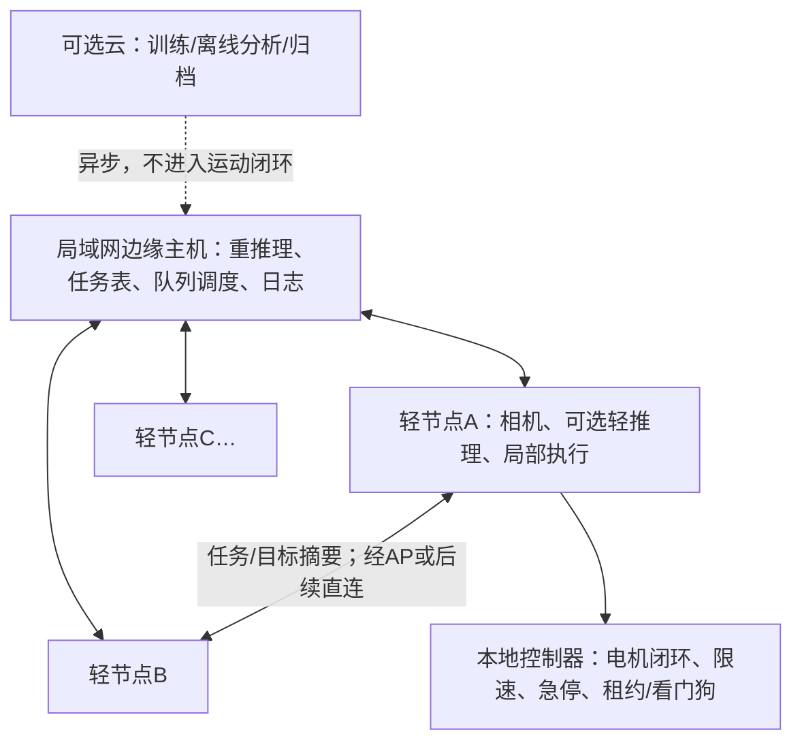

# 架构与技术路线

这是建议设计，尚未实现。方案优先保持“个体轻、主要智能在主机”的意图，同时明确不能卸载的执行边界。

## 计算与控制边界

| 层级 | 首期职责 | 明确不承担 |
| --- | --- | --- |
| 本地MCU/控制器 | 编码器、电机控制、命令合法性、失联停止、必要的近距保护 | 大模型/重视觉，不依赖主机及时响应才能停 |
| 视觉节点 | 采集、编码、时间戳、序号、可选轻筛选、有限缓存 | 首期不要求完整ROS2或SLAM |
| 边缘主机 | 集中重推理、目标去重/复核、任务占用、调度与监控 | 不通过普通Wi-Fi闭合高频电机环 |
| 云（可选） | 训练、离线回放、报告与模型版本 | 首期不承担实时控制，不是必接一层 |

“端边云”是架构扩展能力；无云实验应明确叫端边协同。这里的分布式计算首先指多节点采集/轻处理与主机重处理分工，不默认模型逐层拆给多车并行。

## 通信与协议决定

首期：普通局域网AP星形链路。端端是应用消息关系，可能经AP/主机转发，**不等于已经建成无线Mesh或独立物理直连**。要证明端端价值，应记录相同摘要经中心转发与直接应用通信的差异。

主机/仿真可选Ubuntu 24.04＋ROS2 Jazzy＋Gazebo Harmonic（官方兼容组合）；具体锁定取决于设备SDK。[官方兼容表](https://gazebosim.org/docs/harmonic/ros_installation/)

小型视觉板可通过轻量网络桥接到ROS2；不强制在128/256MB设备上编译完整ROS2。MCU若采用micro-ROS，先确认受支持的板、RTOS和传输，Agent属于依赖点。[micro-ROS Agent](https://github.com/micro-ROS/micro-ROS-Agent)

视频数据与控制消息分开排队。编码先统一JPEG或H.264之一；做算法比较时保持编码器、分辨率和模型一致。早期不同时引入DDS、MQTT、Zenoh、WebRTC和自定义Mesh以免无法归因；若选型更换须保留对照。

## ROS2 QoS边界

KeepLast限制样本缓存；BestEffort允许丢包；Lifespan淘汰过期消息；Deadline是发布/接收时间间隔期望及事件机制，不是网络时延保证。QoS不兼容会无消息，且RMW/驱动实现须验证。[官方源码文档](https://raw.githubusercontent.com/ros2/ros2_documentation/jazzy/source/Concepts/Intermediate/About-Quality-of-Service-Settings.rst)

这些是基线配置，不单独作为创新点。应用还需核对图像采集时间、推理起止时间和命令版本，不能只依赖消息接收时间。

## 数据契约草案

所有消息包括：schema_version、robot_id、boot_id、seq、capture_timestamp、send_timestamp、task_id、expiry、payload_type、payload_bytes、model_version（若适用）。同机耗时用单调时钟；跨机时间要记录时钟同步误差或通过往返估计说明偏差。

| 消息 | 载荷 | 建议策略（待测） |
| --- | --- | --- |
| heartbeat/status | 电量、控制状态、队列长度、时钟状态 | 小消息，受控频率 |
| observation_offer | 图像大小、区域、置信度/新颖性、期限 | 不能免费，计入带宽 |
| observation_data | JPEG/ROI/特征，选择一种先做 | 有界缓存，过期可丢，最新帧替换 |
| inference_result | 类别、置信度、图像序号、时效 | 拒绝对应旧任务/旧boot的数据 |
| task_claim/summary | 已占区域、目标ID、任务版本 | 去重、幂等，限定转发范围 |
| motion_command | 指令、有效期、会话和命令ID | 本地校验；旧指令不能覆盖stop |

## 候选调度，先可解释后学习

每轮先保留控制与状态预算，估计可用上行容量和主机服务时间；过滤预计到达时已过期的观测；在候选观测中兼顾任务效用、单位字节收益、剩余时限和节点最低服务机会；按轮次发放上传令牌。主机对同一节点/同一任务只保留有限个最新待处理样本。

困难：效用评分可能漏掉未知目标；应设置定期探测/随机保底采样，并报告筛选造成的漏检。把“低置信度”视为更值得上传还是更不值得，必须用任务真值决定。

## 复用而不是直接复制

AstraPlusCar已有MotionArbiter、会话/序号/租约与视频广播经验可借鉴，但当前是单车应用，不是多机器人调度器。ROS2swarm提供行为原语参考，官方仓库明确已停止维护，不能声称Jazzy可直接运行。[仓库](https://github.com/ROS2swarm/ROS2swarm)
